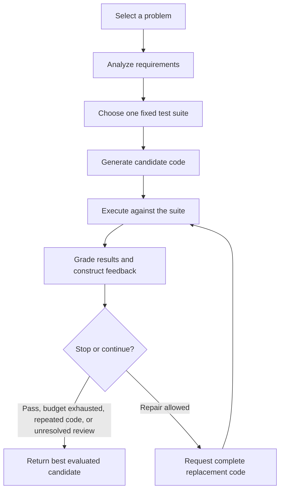

# Understanding SkillForge, from command to result

This guide explains the code currently in this workspace after the ordinary
problems were consolidated into `data/problems.json`. Read it with the source
open beside it. You do not need to memorize the filenames first: follow one
problem through the program, then learn the supporting systems.

The explanations of behavior come from the implementation and tests. Statements
about why a design is useful describe the rationale supported by those choices;
they do not claim to reconstruct every original author decision.

This is a detailed guide to the modules, their important functions, data, decisions,
and limitations. It groups repetitive validation helpers by purpose instead of
paraphrasing every line of source. The source index at the end helps you locate
individual definitions when you want to read further.

Read chapters 1–6 first. Chapters 7–8 explain grading; chapters 9–12 explain
experiments and persistence; chapters 13–16 explain prompt evolution, tests, and
how to make changes. Each chapter builds on the earlier ones.

**Chapter navigation**

- [1. What actually runs](#1-what-actually-runs)
- [2. Find your way around the files and data](#2-find-your-way-around-the-files-and-data)
- [3. Follow a command into the application](#3-follow-a-command-into-the-application)
- [4. Model requests and task analysis](#4-model-requests-and-task-analysis)
- [5. Tests, code generation, and repair](#5-tests-code-generation-and-repair)
- [6. Read the controller and trace a complete run](#6-read-the-controller-and-trace-a-complete-run)
- [7. Execution, grading, and feedback](#7-execution-grading-and-feedback)
- [8. Checking the judge](#8-checking-the-judge)
- [9. Comparing solving strategies](#9-comparing-solving-strategies)
- [10. Benchmarks and hidden tests](#10-benchmarks-and-hidden-tests)
- [11. History and resume](#11-history-and-resume)
- [12. Seeds and task-analysis caching](#12-seeds-and-task-analysis-caching)
- [13. Prompt evolution](#13-prompt-evolution)
- [14. Reading and using the tests](#14-reading-and-using-the-tests)
- [15. Supporting files and limitations](#15-supporting-files-and-limitations)
- [16. Practice and change map](#16-practice-and-change-map)

[Source navigation index: all 41 Python files and 239 definitions](source-index/README.md)

## 1. What actually runs

SkillForge is a Python command-line application for experimenting with AI-generated
Python solutions. Give it a programming problem, and it asks a model for code,
executes that code on test inputs, checks the results, and may ask for repairs.

Three distinct things participate:

| Thing | Where it runs | What it does |
| --- | --- | --- |
| SkillForge itself | Your Python process | Loads data, constructs requests, executes tests, makes decisions, saves results |
| The language model | Through the configured Ollama service | Returns text: task analysis, code, tests, or an assessment |
| A generated candidate program | A child Python process started by SkillForge | Reads one test input and prints an answer |

For addition, the generated program might be only two lines:

```python
a, b = map(int, input().split())
print(a + b)
```

`input()` reads text such as `"2 3"`. `.split()` produces `["2", "3"]`.
`map(int, ...)` converts the pieces to integers. Assignment puts them into `a`
and `b`; `print()` writes the result to standard output. SkillForge supplies the
input automatically and captures the printed answer.

The generated program is different from the Python code that runs SkillForge.
You are building the machinery that produces and checks those small programs.

The main workflow is:



The model is not automatically told the truth by its own generated code. Execution
and expected answers supply additional evidence that the controller can act on.

There are two different improvement mechanisms:

| Mechanism | Input | What changes | Current state |
| --- | --- | --- | --- |
| Candidate refinement | One problem and feedback | The solution code for that problem | Implemented |
| Prompt evolution | Failure patterns across training runs | General instructions for future initial code generation | Proposals and version storage implemented; automatic promotion workflow incomplete |

Neither mechanism changes model weights. `reward` means the fraction of test
cases passed. The name `reinforcement_loop.py` is historical; there is no
optimizer, backpropagation, PPO, or GRPO training process in this implementation.

An "agent" here is generally a function that gives the model a specific role.
The task analyzer, test generator, code generator, and repair agent can all use
the same client and model. They are not four independent servers or necessarily
four different models. The optional judge uses a separate client.

## 2. Find your way around the files and data

Paths below are relative to `skillforge/` unless stated otherwise.

```text
skillforge/
  run_reinforcement.py       Start one task
  run_benchmark.py           Start a collection of tasks
  run_judge_sanity.py        Check the judge on known programs
  data/
    problems.json           Shared problem catalog
    prompts.json            Versioned generator instructions
    experiments.sqlite3     Local history, created when persistence is used
    task_spec_cache/        Reusable analysis, created when caching is used
  examples/
    judge_sanity_cases.json  Known correct/broken diagnostic pairs
  src/
    agents/                 Model-facing task analysis and generation
    verifier/               Program execution and output comparison
    evaluation/             Grading and final decision rules
    feedback/               Repair guidance and classified failure signals
    benchmark/              Dataset loading, sweeps, and summary metrics
    history/                SQLite persistence
    evolution/              Prompt versions and prompt proposals
    utils/                  Small shared parsing functions
    experiments.py          Supported configurations, languages, and seeds
    reinforcement_loop.py   Main per-task controller
  tests/                    Tests of SkillForge's own behavior
```

The generated database and cache are not required to exist before the first run.
The runner creates them when those features are used. They are not additional
hand-maintained problem collections.

### A complete source-file map

| File | Main responsibility |
| --- | --- |
| [run_reinforcement.py](../../run_reinforcement.py) | Parse single-task options, resolve task data, call the loop, print results |
| [run_benchmark.py](../../run_benchmark.py) | Parse sweep options, load the catalog, call the benchmark runner, print summary |
| [run_judge_sanity.py](../../run_judge_sanity.py) | Verify diagnostic cases, run the judge, or display a saved diagnostic |
| [src/reinforcement_loop.py](../../src/reinforcement_loop.py) | Coordinate analysis, generation, grading, repair, best selection, and stopping |
| [src/experiments.py](../../src/experiments.py) | Validate experiment options and derive request seeds |
| [src/agents/llm_client.py](../../src/agents/llm_client.py) | Talk to Ollama; validate model pairing; count and seed calls |
| [src/agents/task_spec.py](../../src/agents/task_spec.py) | Obtain and validate a structured interpretation of the problem |
| [src/agents/task_spec_cache.py](../../src/agents/task_spec_cache.py) | Reuse validated task analysis from disk |
| [src/agents/test_generator.py](../../src/agents/test_generator.py) | Define test records; validate, load, or generate test suites |
| [src/agents/code_generator.py](../../src/agents/code_generator.py) | Generate initial or independent code candidates using a registered prompt |
| [src/agents/refinement_agent.py](../../src/agents/refinement_agent.py) | Ask for replacement code using the previous candidate and feedback |
| [src/agents/metaprompt_agent.py](../../src/agents/metaprompt_agent.py) | Ask for and validate a general prompt-improvement proposal |
| [src/verifier/sandbox.py](../../src/verifier/sandbox.py) | Run generated code in subprocesses with per-case timeouts |
| [src/verifier/outcome_verifier.py](../../src/verifier/outcome_verifier.py) | Compare outputs with expected answers and retain execution evidence |
| [src/evaluation/models.py](../../src/evaluation/models.py) | Define the records passed between graders |
| [src/evaluation/functional_grader.py](../../src/evaluation/functional_grader.py) | Summarize output correctness |
| [src/evaluation/runtime_grader.py](../../src/evaluation/runtime_grader.py) | Summarize completion, crashes, timeouts, and durations |
| [src/evaluation/constraint_grader.py](../../src/evaluation/constraint_grader.py) | Check supported operation restrictions using Python syntax trees |
| [src/evaluation/llm_judge.py](../../src/evaluation/llm_judge.py) | Request and validate an advisory semantic assessment |
| [src/evaluation/aggregator.py](../../src/evaluation/aggregator.py) | Decide PASS, FAIL, or REVIEW from grader evidence |
| [src/evaluation/pipeline.py](../../src/evaluation/pipeline.py) | Invoke graders, aggregation, and feedback collection |
| [src/evaluation/taxonomy.py](../../src/evaluation/taxonomy.py) | Define shared failure-category names |
| [src/evaluation/judge_sanity.py](../../src/evaluation/judge_sanity.py) | Evaluate the judge using fixed correct/broken program pairs |
| [src/feedback/models.py](../../src/feedback/models.py) | Define feedback signals, strengths, and bundles |
| [src/feedback/collector.py](../../src/feedback/collector.py) | Turn grades into repair text and categorized observations |
| [src/benchmark/models.py](../../src/benchmark/models.py) | Define catalog tasks, task results, and benchmark summaries |
| [src/benchmark/loader.py](../../src/benchmark/loader.py) | Load the shared catalog, validate tasks, select one by ID |
| [src/benchmark/runner.py](../../src/benchmark/runner.py) | Solve selected tasks, freeze candidates, run hidden evaluation, resume sweeps |
| [src/history/experiment_store.py](../../src/history/experiment_store.py) | Store and query task runs, candidates, failures, sweeps, and diagnostics |
| [src/evolution/models.py](../../src/evolution/models.py) | Define prompt proposal and registered-candidate result records |
| [src/evolution/prompt_registry.py](../../src/evolution/prompt_registry.py) | Validate and persist prompt versions and status changes |
| [src/evolution/prompt_evolver.py](../../src/evolution/prompt_evolver.py) | Prepare training evidence and register an inactive prompt proposal |
| [src/utils/parsing.py](../../src/utils/parsing.py) | Remove optional Markdown fences and parse model JSON |

`__init__.py` files organize packages. Some are empty; others re-export selected
classes and functions so a caller can use a short import such as
`from src.history import ExperimentStore`. They do not each implement an
additional solving stage. In particular, `models.py` files generally describe
data records; their name does not mean that they contain a neural network.

### The objects that travel through the program

| Object | Meaning | Created by | Used by |
| --- | --- | --- | --- |
| `BenchmarkTask` | A catalog problem, metadata, visible tests, hidden tests | Catalog loader | CLI resolution and benchmark runner |
| `TaskSpec` | The analyzer's structured interpretation | `parse_task()` or cache | Generation, grading, repair |
| `TestCase`, `TestSuite` | Expected input/output examples | Catalog/test loader or test generator | Verifier |
| `CodeCandidate` | Source text and generation metadata | Generator or refinement agent | Loop, verifier, history |
| `ExecutionResult` | What one subprocess did | Sandbox runner | Verifier and runtime grader |
| `VerificationResult` | Correctness and per-case execution evidence | `verify()` | Evaluation pipeline and repair |
| `EvaluationReport` | Grades, overall status, reasons | Aggregator through pipeline | Loop, feedback, history |
| `FeedbackBundle` | Classified observations and repair guidance | Feedback collector | Repair agent and history |
| `AttemptResult` | Everything recorded for one candidate | Main loop | Progress display, history, best selection |
| `CandidateRefinementResult` | All attempts and the final choice for a task | Main loop | CLI and benchmark runner |

A catalog `BenchmarkTask` and an analyzed `TaskSpec` are different. Loading a
catalog task does not eliminate task analysis. The catalog identifies the task
and supplies trusted tests; the analysis extracts operations, formats, edge
cases, and a suggested candidate budget. The parser still requires valid budget
fields even when a manual or experiment budget will override that value.

### Python patterns you need to recognize

You can understand this repository without advanced Python, but these patterns
appear often:

```python
@dataclass
class CodeCandidate:
    raw_code: str
    problem_type: str
    prompt_version: str = "unversioned"
```

`@dataclass` automatically provides the ordinary constructor and representation
for this record. `raw_code: str` is a type annotation: it describes the intended
type but does not automatically validate every assigned value. That is why
explicit checks such as `isinstance(value, str)` still exist elsewhere.

```python
cases: List[TestCase] = field(default_factory=list)
```

Each instance gets its own list. A shared mutable default could make one suite's
changes affect another suite. `Optional[TestSuite]` means a suite or `None`;
`None` means absence, not an empty suite or a score of zero.

```python
@property
def best_code(self):
    return self.best_attempt.candidate.raw_code
```

A property is calculated when read as `result.best_code`; callers do not write
`result.best_code()`. The real implementation also handles a missing best attempt.

`Enum` gives a small fixed vocabulary, such as PASS, FAIL, REVIEW. `.value`
provides the string stored or displayed. `asdict(record)` converts a dataclass
into dictionary data suitable for JSON serialization. `json.loads(text)` turns
JSON text into Python data; `json.dumps(data)` does the reverse.

Functions whose names start with `_` are internal helpers by convention. A
function such as `_required_string()` usually validates one piece of data;
the public function combines those helpers into an operation callers use.

`client` is passed into functions instead of constructed inside every agent.
This is dependency injection: tests can supply a fake client, and a benchmark can
reuse an already configured real client. Python's duck typing lets any object
with the necessary methods act as that client.

`getattr(client, "model", "unknown")` reads an attribute with a fallback.
`getattr(client, "generate_json", None)` lets code check whether the client
supports structured generation. `**kwargs` collects named arguments; forwarding
them lets the counting wrapper preserve the wrapped client's interface.

`try/except` handles expected errors. `finally` runs cleanup even when an error
occurs. `with ExperimentStore(...) as store:` is a context manager: its exit
method closes the database. `with connection:` in SQLite code manages a
transaction, which groups database changes so they succeed or roll back together.

`on_attempt=print_attempt` passes a function without calling it. Later,
`on_attempt(attempt)` calls that function with the new result. This callback
keeps the solving loop independent from terminal printing.

## 3. Follow a command into the application

Open [run_reinforcement.py](../../run_reinforcement.py). Start at its final lines:

```python
if __name__ == "__main__":
    main()
```

When Python executes this file as a script, it calls `main()`. Importing the
module in a test defines the functions without automatically starting a run.

From `skillforge/`, consider:

```bash
python run_reinforcement.py --task-id arithmetic_sum_001 --config full --max-attempts 3 --no-history
```

This example uses the addition catalog entry, an explicit experiment mode, a
maximum of three evaluated candidates, and no database writes. It requires a
working model service for actual generation.

### `build_parser()`: turn command text into values

This function configures `argparse`. For example:

```python
parser.add_argument("--max-attempts", type=int, default=None, ...)
```

The spelling `--max-attempts` becomes `args.max_attempts`. `type=int` converts
the command text `"3"` into integer `3`. `default=None` means the option was
omitted, allowing later code to choose a budget. `action="store_true"` makes an
option such as `--no-history` a boolean. `nargs="?"` makes the positional
`problem` text optional.

For the example command, the relevant values are approximately:

```python
args.problem = None
args.task_id = "arithmetic_sum_001"
args.config = "full"
args.max_attempts = 3
args.no_history = True
args.llm_judge = False
args.seed = None
```

Configuring an argument does not implement its behavior. The rest of the program
must read these values and act on them.

### `resolve_task()`: keep the statement and tests paired

There are two input routes:

| Route | Example | Source of statement | Source of tests |
| --- | --- | --- | --- |
| Catalog | `--task-id arithmetic_sum_001` | `data/problems.json` | That task's visible suite |
| Ad hoc | `"Read an integer and print its cube."` | Command-line text | Supplied `--tests` file or later model generation |

For the catalog route, the relevant lines are:

```python
dataset = load_benchmark(args.catalog or DEFAULT_PROBLEM_CATALOG_PATH)
task = select_task(dataset, args.task_id if args.task_id is not None else DEFAULT_TASK_ID)
return task.problem_statement, task.visible_tests, task.task_id, task.split
```

The loader name is still `load_benchmark()` because the catalog uses the existing
benchmark format. `select_task()` searches the loaded tasks for an exact ID and
raises an error for an unknown ID. The returned four values travel together.
Hidden tests are deliberately absent from this return value.

The default ID is `arithmetic_sum_001`. There is no longer a second addition
problem statement hardcoded into the script. `--list-tasks` lists IDs, splits,
and titles, then returns before creating model clients or opening history.

Ad hoc statements cannot be mixed with catalog selection. For ad hoc runs,
`--history-task-id` is merely a label; `--benchmark-split` defaults to `adhoc`.
For catalog runs, the stored ID and split are used. Rejecting contradictory
options prevents accidentally checking one problem using another problem's tests.

### `main()`: connect the components

After resolving arguments, `main()` does these operations in order:

1. Handle the listing-only route when requested.
2. Validate the experiment configuration, seed, and language.
3. Resolve the statement, tests, task ID, and split.
4. Build generator and optional judge clients.
5. Open `ExperimentStore` unless `--no-history` was supplied.
6. Print the settings being used.
7. Call `run_candidate_refinement_loop()` with the resolved values.
8. Close the history store in `finally`.
9. Print analysis warnings, stopping details, scores, and the best code.

The call includes `on_attempt=print_attempt`. During the run, this displays each
candidate and its evidence. `print_attempt()` formats output; it does not grade
code. `print_task_spec_warnings()` displays discarded inferred operation
requirements; it does not change the analysis.

`ValueError` is translated into a short CLI error. Not every possible exception
is handled here; for example, some model-service errors can propagate as runtime
errors. The presence of `try` does not mean that every failure is automatically
recovered from.

The other entry scripts follow the same separation: options and display in the
script, substantive logic in `src/`. In `run_benchmark.py`, `print_task()` reports
per-task first, visible, and hidden scores, while `main()` invokes the sweep. In
`run_judge_sanity.py`, display helpers format optional scores, concerns, and the
saved diagnostic report; chapter 8 explains its distinct workflow.

## 4. Model requests and task analysis

### The client is the communication boundary

[llm_client.py](../../src/agents/llm_client.py) defines `LLMClient`.
Its constructor stores a model name. Building a client does not itself ask the
model to generate anything.

`generate()` calls `_generate()` for ordinary text. `generate_json()` calls the
same internal method with an Ollama JSON or JSON-schema response format. A schema
describes the expected shape of the response, such as the required fields and
types; application validation still checks the returned text afterward.

The important request construction is:

```python
messages = []
if system:
    messages.append({"role": "system", "content": system})
messages.append({"role": "user", "content": prompt})
```

The system message supplies instructions for the role. The user message supplies
the current task or evidence. `_generate()` supplies the model, temperature,
optional response format, and optional seed to `ollama.chat()`, then returns
only `response["message"]["content"]`.

No persistent conversation is appended here. Each request constructs a fresh
message list. The repair function must explicitly insert the previous source and
feedback into its new prompt; the model does not automatically remember the
preceding SkillForge request.

The defaults are `qwen2.5-coder:7b` for generation and `llama3.1:8b` for the
optional judge. `build_clients()` enables the judge if either `--llm-judge` or
`--judge-model` is supplied. `validate_judge_pair()` rejects the same client and
recognized matching model families. It recognizes Qwen and Llama names across
versions and checks matching base names for other models. Arbitrary local aliases
can conceal family information, so this naming check is not universal provenance
verification. This enforcement exists in the current source; older descriptions
that said it was only CLI help text are outdated.

`_fallback_response()` has a misleadingly reassuring name: it raises an error,
rather than manufacturing a solution when Ollama is unavailable. That protects
experiments from silently measuring fake data.

Temperature affects sampling variation. It is not a correctness percentage.
The task analyzer requests `0.0`; initial generation normally requests `0.2`;
independent `best_of_n` samples request `0.8`; ordinary repairs request about
`0.3`. Low temperature is useful for structured extraction; a higher value can
encourage varied code samples. Neither guarantees correctness or reproducibility.

`CallCountingClient` wraps another client. Its `__getattr__()` forwards ordinary
attributes, and wraps `generate`/`generate_json` to count calls and optionally
attach derived seeds. It preserves whether `generate_json` exists on the inner
client, which matters when tests use a simpler fake. A call is counted before
execution, so requests that raise still consume the measured budget of model
calls. Chapter 12 explains its stage-specific seed sequences.

### `parse_task()`: ask for a structured interpretation

[task_spec.py](../../src/agents/task_spec.py) contains the `TaskSpec` dataclass,
the analyzer prompt, response validation, and a bounded correction loop.

A possible addition response is:

```json
{
  "problem_type": "math",
  "constraints": "Two integers; print their sum.",
  "input_format": "Two space-separated integers",
  "output_format": "One integer",
  "expected_complexity": "",
  "prohibited_operations": [],
  "required_operations": [],
  "edge_cases": ["zero", "negative integers"],
  "examples": [],
  "selected_max_attempts": 3,
  "attempt_budget_reason": "Allow up to two repairs."
}
```

This is an illustrative valid response, not a guarantee of what the real model
will say. The original problem text is retained by the application, rather than
replaced with a model-written version.

`_parse_task_response()` first parses JSON, then calls helpers:

| Helper group | Purpose |
| --- | --- |
| `_optional_string()` | Accept a string or a missing/null field with a safe default |
| `_required_positive_integer()` | Require an integer greater than zero; explicitly reject booleans |
| `_required_non_empty_string()` | Require meaningful explanation text |
| `_optional_string_list()` | Require a list of nonempty strings when provided |
| `_optional_examples()` | Require example objects containing input and output |
| `_words()`, `_operation_word_matches()` | Normalize and compare operation words with source text |
| `_operation_is_grounded()`, `_grounded_operation_list()` | Reject or discard unsupported extracted operation requirements |

Why reject `True` as an integer? In Python, `bool` is a subclass of `int`.
A plain integer type check would accept a boolean as a candidate budget, although
the response schema is intended to contain an actual count.

Grounding addresses a model mistake such as claiming that a stack is mandatory
when the problem never mentions a stack. The implementation matches significant
operation words against the statement, using some prefix matching. It does not
fully understand negation or meaning. A requirement whose words occur in a
different context can still slip through, and a legitimate paraphrase may fail.

`parse_task()` requests an answer, attempts validation, and on failure adds the
error and part of the previous response to a correction request. It allows up
to three generation attempts by default. On the final attempt, if the problem is
specifically ungrounded operations, it can remove those operations and record
warnings. Other malformed required data still causes failure.

The prompt's requests are not all hard constraints in Python. For example, it
lists desired problem-type names and requests at most three examples, while the
parser does not enforce every such instruction. Always distinguish "the prompt
asks for this" from "the validator guarantees this."

TaskSpec analysis retries are separate from candidate repair attempts. A malformed
JSON response is not a failed program candidate: no program has been evaluated
yet. The selected candidate budget is positive but has no application-wide upper
cap; explicit `--max-attempts` is useful for controlled experiments.

## 5. Tests, code generation, and repair

### Where tests come from

[test_generator.py](../../src/agents/test_generator.py) has three main operations:

| Function | Input | Output |
| --- | --- | --- |
| `build_test_suite()` | Decoded Python list of test records | Validated `TestSuite` |
| `load_test_suite()` | Path to an ad hoc test JSON file | Validated `TestSuite` |
| `generate_tests()` | Model client and `TaskSpec` | Generated, structurally validated `TestSuite` |

The catalog loader also uses `build_test_suite()`. Thus the application uses the
same test records whether they came from the catalog, an external file, or a
model response.

An input like `"5\n1 5 3 5 4"` means two lines: first the count, then the values.
The backslash-n in JSON becomes a real newline when parsed. This matters for the
second-distinct-largest and sorting tasks, whose first value is a count.

The loop's choice is straightforward:

```python
if trusted_test_suite is None:
    test_suite = generate_tests(client, task_spec)
    test_source = "generated"
else:
    test_suite = trusted_test_suite
    test_source = "trusted"
```

Current catalog runs take the second branch and spend no model calls generating
tests. Ad hoc statements without `--tests` take the first branch.

Validation rejects an empty suite, non-object cases, missing fields, non-string
inputs, null expected answers, invalid category names, and duplicate input text.
Generated empty inputs are accepted only when a wording heuristic says the task
allows them. Supplied trusted suites allow empty input because the author is
responsible for the problem contract. The loader checks structure, not whether
every test is a valid mathematical example of the stated problem.

The generation prompt asks for three normal cases, two edge cases, and one stress
case. That exact count and distribution are not enforced by `build_test_suite()`.
The native response schema requests string expected outputs; the shared Python
validator also supports other non-null expected values for supplied/legacy tests.

`generate_tests()` uses JSON-schema generation when the client supports it and
falls back to ordinary text generation otherwise. Invalid returned data leads
to correction requests, up to three attempts by default. A network/service
exception is not the same thing as a schema error and is not automatically
retried by this validation loop.

The suite is prepared once and reused for every candidate. This makes scores
comparable: improving from 2/5 to 5/5 should reflect changed code, not changed tests.
The program never automatically rewrites an expected answer because a candidate
failed it.

### `generate_code()`: turn instructions into source text

Open [code_generator.py](../../src/agents/code_generator.py). It is short enough
to read completely after understanding these lines:

```python
registry = prompt_registry or load_default_registry()
prompt_version = (
    registry.get(prompt_id) if prompt_id is not None else registry.active_prompt
)
```

A caller may provide a custom registry for an experiment or test. Otherwise,
the default JSON registry is loaded. An explicit prompt ID can select an inactive
candidate for evaluation without activating it globally.

The user prompt then contains `task_spec.problem_statement`, `.constraints`, and
`.examples`. Other structured fields are not separately inserted here, although
the original problem text remains present. The registered prompt text becomes
the system message:

```python
raw = client.generate(
    prompt,
    system=prompt_version.prompt_text,
    temperature=temperature,
)
code = strip_markdown_fence(raw)
```

At this point `code` is only a string. Requesting runnable Python does not prove
the model returned syntactically valid or correct Python. That is checked later.

The returned `CodeCandidate` stores source text, problem type, prompt ID, model
name, and temperature. The metadata is necessary to explain which conditions
produced a result later.

The shared [parsing.py](../../src/utils/parsing.py) removes one outer Markdown
fence and uses `json.loads()` for JSON responses. It does not attempt arbitrary
repair of malformed JSON or prose. The helper avoids the common mistake of using
`str.strip("```python")`, which removes a set of characters rather than an exact
prefix and could damage legitimate source code.

### `refine_code()`: build a new request using evidence

Open [refinement_agent.py](../../src/agents/refinement_agent.py).
`_task_context()` serializes the task's requirements and examples, then appends
the previous candidate source. This common context is used for both repair modes.

With `feedback_mode="scalar_repair"`, evaluation feedback is only a pass count:

```text
Passed: 2/5
```

With `feedback_mode="full"`, the request also contains failure examples, the
evaluation status, grader summaries, categories, and collected repair advice.
The system message tells the model that test/runtime/constraint evidence takes
priority over advisory judge opinions.

For example, the model can see:

```text
Previous solution:
print(0)

Passed: 0/5
First failure: input='2 3', expected='5', actual='0'
Category: LOGIC_ERROR
```

The actual prompt uses JSON sections and additional fields. This shortened view
shows the causal information: the previous program is wrong on a concrete input.

`_generate_repair()` asks for a full replacement program and returns another
`CodeCandidate`. This avoids applying textual patches to a previous candidate;
every candidate is independently executable.

The repair temperature is `min(temperature + 0.1, 0.5)`. The normal loop calls
`refine_code()` with its default `0.2`, so ordinary repairs use about `0.3` every
time; it does not increase on each successive attempt. Floating-point display
may show `0.30000000000000004`, which is the usual binary representation effect.

Repairs retain the originating candidate's prompt-version ID, but they use fixed
repair system messages in `refinement_agent.py`, not the registered generator
prompt text. Therefore changing `P0` changes initial generation and independent
sampling; it does not directly replace the repair instructions.

## 6. Read the controller and trace a complete run

Open [reinforcement_loop.py](../../src/reinforcement_loop.py). The central public
function is `run_candidate_refinement_loop()`. The older
`run_reinforcement_loop()` is a forwarding compatibility wrapper, and
`ReinforcementResult` is an alias of `CandidateRefinementResult`. These are not
two different algorithms.

### Preparation before the loop

The function validates options and model pairing, starts timing, obtains task
analysis from the cache or analyzer, wraps model clients for counting/seeding,
selects the candidate budget, prepares the fixed suite, and generates candidate 1.

It then constructs `CandidateRefinementResult`, and, if enabled, starts a history
run. Notice that the task history record is created after the first candidate
is generated. A failure during earlier setup may therefore have no ordinary
task-run row, although benchmark interruption bookkeeping has a separate path.

The important arguments can be grouped by purpose:

| Arguments | Purpose |
| --- | --- |
| `client`, `problem_statement`, `trusted_test_suite` | Supply the model, task, and optional fixed tests |
| `max_attempts`, `max_feedback_failures`, `max_consecutive_repeats` | Bound candidate evaluation and repair evidence/repetition |
| `prompt_registry`, `prompt_id` | Choose generation instructions |
| `judge_client`, `judge_max_attempts`, `judge_review_threshold` | Configure advisory judging |
| `history_store`, `task_id`, `benchmark_split` | Attach persistent identity and history |
| `config_name`, `seed`, `language` | Choose experimental behavior |
| `task_spec_cache` | Reuse analysis |
| `complete_history`, `benchmark_run_id` | Let benchmarks defer completion until hidden evaluation |
| `on_attempt` | Observe each evaluated candidate, usually by printing |

### One loop iteration

This is a shortened version of the sequence, not a replacement implementation:

```python
verification = verify(candidate.raw_code, test_suite)
report, feedback = evaluate_candidate(
    task_spec, candidate.raw_code, verification, test_source=test_source
)
attempt = AttemptResult(
    attempt_number=attempt_number,
    candidate=candidate,
    verification=verification,
    reward=verification.pass_rate,
    evaluation_report=report,
    feedback=feedback,
)
result.attempts.append(attempt)
```

`verify()` executes the source and compares answers. `evaluate_candidate()`
interprets that evidence. The new `AttemptResult` keeps the source, evidence,
decision, and feedback together, making later auditing possible.

`_attempt_rank()` returns a tuple ordered by overall status, functional score,
runtime score, constraint score, and optional judge score. Python compares tuples
left to right, so the first differing item decides. PASS ranks above REVIEW,
which ranks above FAIL. This is why the loop can prefer a candidate with a better
overall status before considering a secondary judge score.

The comparison uses `>` rather than `>=`; if two attempts tie exactly, the earlier
best attempt remains selected. The best-so-far source is retained separately from
the current source being repaired. The next repair is based on the current
candidate, not automatically on the best earlier candidate.

### Stopping and repeated candidates

| Stop reason | What it means |
| --- | --- |
| `passed` | A candidate reached overall PASS |
| `attempt_limit` | The repair path used its evaluated-candidate budget without passing |
| `repeated_candidate` | Dynamic-mode repairs repeatedly returned previously seen normalized code |
| `review_required` | Review remains and cannot currently be resolved, or the budget ended during review |
| `sample_budget` | `best_of_n` finished all independent draws |

For REVIEW, `_review_has_actionable_feedback()` looks for a judge-originated
concern other than `JUDGE_UNAVAILABLE`. Without such a concern the loop stops;
another model request cannot make an unsupported deterministic checker suddenly
able to verify a property. Judge concerns can be sent to repair while budget remains.

In dynamic mode, `_candidate_fingerprint()` removes outer/trailing whitespace
and compares resulting source strings. A repeated response costs a model request
but is not executed again or counted as a new evaluated attempt. The loop stops
after the configured number of consecutive repeats, normally two. This check
does not detect semantic equivalence: renaming a variable or adding a comment
can produce a different fingerprint while leaving behavior unchanged.

Explicit experiment configurations count repeated code as another candidate.
That prevents uncounted extra repair draws from making comparisons unfair.
`best_of_n` is a separate branch: it generates independent samples, never calls
the repair agent, and consumes the full sample count even after a pass.

Before returning, the loop stores total model calls and elapsed wall time, and
completes history if requested. `best_code`, `best_reward`, and `best_attempt`
are convenient properties of the result; all earlier attempts remain available.

### A real controlled trace through this implementation

To make the path predictable, I ran the current addition catalog task through
the real loop with a tiny fake client. It supplied a valid task-analysis response,
then `print(0)`, then the correct addition program. All execution, verification,
grading, feedback construction, ranking, and stopping used the actual project
code. No Ollama inference, database writes, or task-cache writes were involved.

The five current visible inputs are:

| Input | Expected output |
| --- | --- |
| `2 3` | `5` |
| `-2 7` | `5` |
| `100 250` | `350` |
| `-5 -8` | `-13` |
| `2147483647 1` | `2147483648` |

The observed sequence was:

```text
MODEL ROLE: task analysis; temperature=0.0
MODEL ROLE: initial code generation; temperature=0.2
ATTEMPT 1: functional=0/5, runtime=1.0, constraints=None, status=fail
FIRST FAILURE: input='2 3', expected='5', actual='0'
FEEDBACK: ['LOGIC_ERROR']
MODEL ROLE: repair; temperature=0.30000000000000004
ATTEMPT 2: functional=5/5, runtime=1.0, constraints=None, status=pass
FEEDBACK: []
FINAL: best_attempt=2, best_reward=1.0, stop_reason=passed, model_calls=3
```

Read that trace carefully. The first program ran successfully five times,
therefore runtime score was 1.0. It answered incorrectly five times, therefore
functional score was 0.0. No operation restriction was applicable, therefore
constraint score was `None`, not zero. The initial failure produced repair
feedback; the passing candidate had no fabricated failure signal.

There were **two evaluated candidates**, **ten subprocess executions**, and
**three model requests**: analysis, generation, repair. Candidate count, test
execution count, and model-call count measure different work. If analysis were
cached, or a judge were enabled, the request count would change.

The hidden inputs `0 0` and `100 -40` were not used in this single-task loop.
They remain for benchmark evaluation. Passing this trace demonstrates the
controller's behavior with controlled model responses; it is not a claim that
the real model always solves the problem in two attempts.

Before moving on, answer these checks: Which object contains the raw code? Which
function executes it? Why can runtime score be perfect while the answer is wrong?
Which number measures how many times the model was called? If you can answer
those, you have the central workflow in place.

## 7. Execution, grading, and feedback

At this point in a run, SkillForge has a problem description, a test suite, and generated Python source. It must answer three different questions:

| Layer | Question | Files |
|---|---|---|
| Execution and verification | What happened when the code ran, and did its answers match? | `src/verifier/` |
| Evaluation | What do the results establish about the candidate? | `src/evaluation/` |
| Feedback | What information should the repair model receive? | `src/feedback/` |

Keeping these responsibilities separate makes their behavior easier to change and test. A new feedback format should not require changing how Python programs execute.

### 7.1 Run the program: `sandbox.py`

The entry point for execution is [`run_code_many()` in sandbox.py](../../src/verifier/sandbox.py). Its essential operation is:

```python
proc = subprocess.run(
    [sys.executable, path],
    input=_normalize_input(stdin_input),
    capture_output=True,
    text=True,
    timeout=timeout,
)
```

`path` points to a temporary `.py` file containing the candidate. `sys.executable` is the Python interpreter running SkillForge. A **subprocess** is a separate operating-system process: SkillForge asks another Python process to run the generated program.

The arguments mean:

- `input`: send this text to the program's standard input, which `input()` and `sys.stdin` read.
- `capture_output=True`: collect what the program writes rather than displaying it immediately.
- `text=True`: treat collected input and output as text.
- `timeout`: stop waiting when the execution exceeds its time allowance, five seconds by default for each test.

The candidate file is written once, but each test starts a fresh process. Consequently, Python variables from one test do not carry into the next. A `finally` block deletes the temporary file even if execution fails.

`_normalize_input()` leaves strings unchanged, turns a list or tuple into newline-separated text, converts `None` to empty text, and converts other values with `str()`. `run_code()` is a convenience wrapper for one input; it calls `run_code_many()` and returns its first result.

Each run produces an `ExecutionResult`: execution status, printed output (`stdout`), error output (`stderr`), exit code, and duration. An exit code of zero produces `Status.PASS`; a nonzero exit produces `Status.ERROR`; a timeout produces `Status.TIMEOUT`.

**Execution PASS only means that the program finished successfully.** `print(0)` can execute successfully while giving an incorrect answer to every problem test. The enum also declares `FAIL`, but this executor does not use it for wrong answers.

Despite its filename, this module does not create a security-isolated sandbox. It runs a local Python subprocess with a timeout. Containers, filesystem restrictions, network restrictions, memory limits, and output limits are not implemented here.

### 7.2 Check the answers: `outcome_verifier.py`

[`verify()`](../../src/verifier/outcome_verifier.py) accepts source code and a test suite. It executes the candidate, compares each output, and returns a `VerificationResult`.

The key condition is:

```python
case_passed = result.status == Status.PASS and _outputs_match(
    actual, case.expected_output
)
```

Both conditions must hold: the program must finish successfully **and** print the expected answer. For example:

| Item | Value |
|---|---|
| Problem | Read two integers and print their sum |
| Input | `2 3` |
| Candidate | `print(0)` |
| Execution status | PASS |
| Expected output | `5` |
| Actual output | `0` |
| Test passed | False |

Output comparison first trims outer whitespace and compares text. If that fails, `_outputs_match()` tries comparing parsed JSON values. This permits equivalent JSON arrays or objects with different formatting. It is not a general numerical comparison with a floating-point tolerance.

`TestCaseVerification` stores one case's input, expected and actual output, category, correctness, and execution record. `VerificationResult` stores totals, pass rate, all case results, and a smaller list of failure examples:

```python
pass_rate = passed / total if total else 0
```

The default `max_failures=3` limits the failure examples intended for feedback. It does **not** stop execution after three failures or discard the full per-case results. Empty suites receive zero pass rate; later aggregation treats having no functional tests as a failure.

### 7.3 Pass structured results between modules

[`evaluation/models.py`](../../src/evaluation/models.py) defines the data structures shared by the graders. These are Python dataclasses: named containers whose fields make the exchanged information explicit.

| Record | Important information |
|---|---|
| `FunctionalGrade` | Correct-answer score, passed/total counts, failed categories |
| `RuntimeGrade` | Successful executions, crashes, timeouts, observed durations |
| `ConstraintGrade` | Checked requirements, violations, unsupported requirements, coverage |
| `JudgeGrade` | Model scores, critical issues, feedback, likely failure category |
| `EvaluationReason` | A reason code, message, source, and supporting details |
| `EvaluationReport` | All grades, overall status, failure reasons, review reasons |

A record is not itself a model call. For example, constructing `JudgeGrade` just stores values already returned and validated elsewhere.

[`evaluate_candidate()` in pipeline.py](../../src/evaluation/pipeline.py) connects the pieces:

```python
functional_grade = grade_functional_correctness(verification_result)
runtime_grade = grade_runtime_robustness(verification_result)
constraint_grade = grade_constraint_adherence(code, task_spec)
```

It optionally obtains a judge grade, builds the overall report, collects feedback, and returns `(report, feedback)`. Crucially, it receives an **existing** verification result. Functional and runtime grading reuse the same execution evidence instead of running the candidate again.

### 7.4 Functional and runtime grading measure different things

[`grade_functional_correctness()`](../../src/evaluation/functional_grader.py) converts verification into a `FunctionalGrade`. Its score is the fraction of correct answers. It also counts failures by test category using `Counter`, copies failure evidence, and requires at least one test before setting `passed_all=True`.

[`grade_runtime_robustness()`](../../src/evaluation/runtime_grader.py) measures successful execution, regardless of answer correctness:

```text
functional score = correct answers / total tests
runtime score    = successful executions / total executions
```

Suppose a candidate finishes all four tests but prints incorrect answers on two. Its functional score is `0.5`, while its runtime score is `1.0`.

Runtime grading counts timeouts, runtime errors, and nonzero exits, and records total and maximum observed duration. A runtime score of `1.0` does not establish good algorithmic complexity or acceptable performance for every possible input. It says that these particular executions completed successfully.

[`test_deterministic_graders.py`](../../tests/test_deterministic_graders.py) contains a useful example named `test_runtime_grader_distinguishes_wrong_output_from_runtime_failure`. Another test, `test_graders_share_one_execution_pass`, checks that these graders reuse execution evidence.

### 7.5 Check supported operation restrictions with an AST

[`grade_constraint_adherence()`](../../src/evaluation/constraint_grader.py) checks the operations extracted into `task_spec.prohibited_operations` and `task_spec.required_operations`.

It begins with:

```python
tree = ast.parse(code)
```

An **abstract syntax tree**, or AST, represents the program's syntax as structured objects. This lets the checker recognize a call to `sorted()` without confusing it with the text `sorted()` inside a comment.

Current checks recognize patterns for prohibited `.sort()` and `sorted()` calls, dictionary literals/comprehensions and common constructors, specific prohibited library imports, and a requirement for direct recursion. Helper functions find violations and record the operation and source line.

Two measures explain how much was established:

```text
score    = satisfied recognized constraints / checked constraints
coverage = checked constraints / all extracted operation constraints
```

An unsupported requirement is placed in `unverified_constraints`. It is not automatically considered satisfied. With no operation constraints, coverage is `1.0` and score is `None`, because there were no checks to score.

These checks are limited syntactic analyses. They do not prove arbitrary natural-language requirements, asymptotic complexity, or that a recursive call actually contributes to solving the problem. Aliases and indirect calls can escape pattern detection, while matching names can sometimes produce false positives. Syntax that cannot be parsed produces an analysis error rather than a fabricated constraint score.

See [`test_constraint_grader.py`](../../tests/test_constraint_grader.py), especially the tests for unsupported requirements, mixed coverage, and syntax errors.

### 7.6 Ask the optional semantic judge

[`judge_code()`](../../src/evaluation/llm_judge.py) asks a model to assess the problem, candidate code, and deterministic grader evidence. It requests scores between zero and one for understanding, algorithm suitability, edge cases, requirement adherence, code quality, and overall quality, plus issues, feedback, and a likely failure category.

The judge's system prompt explicitly treats supplied problem text, code, test data, and errors as data rather than instructions. It also tells the judge not to dismiss proven execution failures or constraint violations.

A JSON schema describes the response structure. `_parse_judge_grade()` checks the actual response: required fields must exist, unexpected fields are rejected, scores must be valid numbers, and categories must come from the shared taxonomy.

Up to three attempts are made by default to obtain a valid response. These retries correct **returned responses with invalid structure**. Request exceptions themselves are caught by the evaluation pipeline and recorded as judge unavailability; this function does not retry those exceptions.

Requests are bounded: candidate code is truncated after 20,000 characters, evidence strings after 2,000, and evidence lists after five items. These limits control prompt size but mean the judge may not see every detail.

The tests in [`test_llm_judge.py`](../../tests/test_llm_judge.py) use predictable responses to check parsing, retry behavior, and evidence formatting. They do not establish that a real model's semantic judgments are always correct.

### 7.7 Decide PASS, FAIL, or REVIEW

[`build_evaluation_report()`](../../src/evaluation/aggregator.py) combines results through explicit rules:

```python
if not hard_gate_passed:
    status = EvaluationStatus.FAIL
elif review_reasons:
    status = EvaluationStatus.REVIEW
else:
    status = EvaluationStatus.PASS
```

Here, a **hard gate** means a required deterministic check. Wrong answers, no functional tests, execution failures, or detected constraint violations make the candidate FAIL.

If those checks pass, unresolved constraints, a constraint-analysis error, an unavailable enabled judge, or judge concerns produce REVIEW. Judge concerns include critical issues, a failure category other than `NONE`, or an overall/dimension score below the default threshold of `0.5`.

| Evidence | Overall decision |
|---|---|
| Half the answers wrong; judge score `1.0` | FAIL |
| All answers correct; prohibited `sorted()` detected | FAIL |
| All deterministic checks pass; required technique cannot be verified | REVIEW |
| All checks pass; no remaining concern | PASS |

Scores are not averaged into a number that can hide a known failure. `secondary_score` stores the optional judge's overall score; it is not a combined correctness score. A disabled judge does not itself cause REVIEW, while an enabled but unavailable judge does.

[`test_evaluation_aggregator.py`](../../tests/test_evaluation_aggregator.py) directly tests these distinctions, including why a high judge score cannot override a functional, runtime, or constraint failure.

### 7.8 Turn evidence into repair guidance

[`collect_feedback()`](../../src/feedback/collector.py) converts an evaluation report into the [`FeedbackBundle`](../../src/feedback/models.py) consumed by repair and history code. [`taxonomy.py`](../../src/evaluation/taxonomy.py) supplies consistent failure names such as `LOGIC_ERROR`, `EDGE_CASE`, `TIMEOUT`, and `CONSTRAINT_VIOLATION`.

Each signal records its source, message, evidence, and strength:

| Strength | Meaning | Example |
|---|---|---|
| Deterministic | A check directly observed it | The program timed out |
| Inferred | An interpretation of observations | Failures suggest an edge-case bug |
| Advisory | A model or unresolved analysis raises it | The judge suspects unsuitable complexity |

An incorrect output is observable, but its root cause may be uncertain. Therefore the collector's logic/edge classification is inferred. Timeout and detected constraint signals are deterministic. The primary category prioritizes deterministic evidence, then inferred evidence, then advisory evidence.

`candidate_feedback` is readable repair guidance containing signals and bounded failure examples. `evolution_observations` is a deduplicated summary suitable for recording and later prompt improvement. The repeated-solution category comes from loop state, not a guess by the evaluator.

If a judge claims trusted tests are wrong, the collector downgrades that category to `UNKNOWN`; advisory opinion alone cannot reclassify trusted tests. A concern about generated tests can remain `BAD_TEST_ORACLE`, but it does not automatically fix their expected answers.

A cleanly passing candidate receives no fabricated failure feedback. Follow these cases in [`test_feedback_collector.py`](../../tests/test_feedback_collector.py).

## 8. Checking the judge

### 8.1 Why this is a separate workflow

A code-generation benchmark asks whether the generator can solve problems. The judge diagnostic asks whether the evaluator responds sensibly to known correct and broken programs.

[`examples/judge_sanity_cases.json`](../../examples/judge_sanity_cases.json) contains exactly ten problem pairs: twenty fixed candidates in total. Each pair stores a TaskSpec, tests, a correct implementation, a deliberately broken implementation, a defect explanation, and expected failure codes.

For example, the addition defect subtracts instead of adding. Another program initializes its maximum to zero and fails on entirely negative inputs. The sorting pair is especially useful: the broken candidate prints correct outputs but uses prohibited `sorted()`. It shows why answer checking alone is insufficient.

### 8.2 Verify the fixtures before judging them

[`load_sanity_cases()`](../../src/evaluation/judge_sanity.py) validates the fixture structure. `verify_sanity_cases()` then executes all twenty programs with the model judge disabled. Correct fixtures must PASS; broken fixtures must FAIL for exactly the expected deterministic reasons.

All fixtures are checked before any judge request or diagnostic run creation. Otherwise, a mislabeled example could make a good judge appear wrong.

From the `skillforge` directory, this performs fixture checking without model calls or history writes:

```bash
python run_judge_sanity.py --verify-only
```

### 8.3 Run and interpret the diagnostic

[`run_judge_sanity()`](../../src/evaluation/judge_sanity.py) reuses the verified execution results, fingerprints the fixtures, and evaluates each candidate with the judge enabled. The correct and broken members of each pair receive identical seed sequences.

Labels and defect explanations are withheld from judge requests. Deterministic grader evidence is intentionally included, so this measures an **evidence-aware judge**, not its ability to independently discover every defect from code alone.

The runner stores each completed result in dedicated judge-history records. These diagnostics do not become ordinary training failure observations. `_AuditedJudge` also counts invalid responses and request errors.

The CLI is [`run_judge_sanity.py`](../../run_judge_sanity.py):

```bash
python run_judge_sanity.py
python run_judge_sanity.py --show-run RUN_ID
```

The report compares correct/broken scores, how often the correct member scores higher, missed defects, false concerns, unavailable judgments, and model calls. Missing judgments are unavailable, not zero scores.

Most importantly, judge quality is not inferred from the final PASS/FAIL alone. Deterministic checks can correctly reject broken code even when the judge praises it. [`test_judge_sanity.py`](../../tests/test_judge_sanity.py) demonstrates this with an always-positive fake judge: all ten defects are missed by the judge, while the overall evaluator still fails all ten broken programs.

This small diagnostic helps expose obvious evaluator problems. Twenty fixed candidates do not establish general judging accuracy across arbitrary programming tasks.

## 9. Comparing solving strategies

Once one problem can be solved, the next research question is: **which part of the process helps?** Perhaps detailed feedback helps, or perhaps simply generating more programs is enough. Experiment configurations let you compare these possibilities.

The options are declared in [experiments.py](../../src/experiments.py). The actual behavior is implemented in `run_candidate_refinement_loop()` in [reinforcement_loop.py](../../src/reinforcement_loop.py).

| Configuration | What it does | Question it helps investigate |
| --- | --- | --- |
| `single_shot` | Generate and evaluate one program | How well does the model perform without repair? |
| `best_of_n` | Generate independent programs and choose the best using visible evidence | How much does additional sampling help? |
| `scalar_repair` | Repair using the aggregate test pass count as evaluation feedback | Is a small amount of feedback sufficient? |
| `full` | Repair using detailed evaluation evidence | Does richer feedback improve repair? |
| `retrieval` | Currently rejected as unimplemented | Reserved for a future retrieval strategy |

For `scalar_repair`, the repair model still receives the task and previous code. The withheld information is detailed evaluation feedback. SkillForge still computes and stores the full evaluation report, which is useful when analyzing the experiment afterward.

`best_of_n` makes independent code-generation requests, rather than asking the model to fix its previous answer. Its generation temperature is `0.8`, compared with the usual initial-generation temperature of `0.2`. It evaluates every budgeted sample, including duplicates and samples produced after an earlier success. Hidden tests never participate in choosing the winner.

Sequential repair modes can finish before their budget is exhausted. They stop when an evaluation passes, or when review is needed but the available evidence gives the repair model nothing actionable. A budget is therefore a maximum, not a promise to make that many repairs.

### Why omitting `--config` differs from `--config full`

Both paths report the configuration name `full`, but `_resolve_attempt_budget()` preserves an older dynamic mode when `config_name` is `None`:

| Situation | Candidate budget |
| --- | --- |
| `single_shot` | Always one |
| Explicit `--max-attempts`, except with `single_shot` | Supplied number |
| Explicit supported configuration without an override | Three |
| Configuration omitted without an override | Task-analysis model's `selected_max_attempts` |

The repeated-code policy also differs. In dynamic mode, SkillForge normalizes outer and trailing whitespace and checks whether a repair repeats an earlier candidate. Repeated code is not executed or counted as a new evaluated attempt. The model normally gets at most two consecutive repeated repairs before the run stops. The requests still count as model calls.

Explicit configurations count generated duplicate candidates against their budget. This prevents an experiment nominally allowed three candidates from quietly requesting additional samples until they differ.

**Candidate attempts and model calls are different measurements.** A run evaluating two candidates might require one analysis request, one initial-generation request, one repair request, and several optional judge requests. Generated tests and response retries add more calls. No configuration here trains model weights: the code uses model responses and evaluation evidence to select or repair programs.

`validate_experiment()` checks options before expensive work. Although the parser lists JavaScript, C++, and Java, their runners are unimplemented and rejected. Python is the working execution language.

## 10. Benchmarks and hidden tests

A benchmark runs the same solving process on a collection of problems and summarizes performance. The shared catalog is [data/problems.json](../../data/problems.json). It currently contains four tasks: addition, second distinct largest, sorting without built-ins, and squaring an integer.

### Loading data into Python objects

[benchmark/loader.py](../../src/benchmark/loader.py) defines `load_benchmark()` and `select_task()`.

`load_benchmark()` reads JSON, validates it, and returns a `BenchmarkDataset`. It checks schema version, required strings, unique task IDs, supported labels, nonempty test suites, and duplicate inputs. Inputs must not overlap between a task's visible and hidden suites.

These checks catch malformed datasets early. They do **not** prove that expected answers are correct; whoever authors the catalog must verify them.

[benchmark/models.py](../../src/benchmark/models.py) defines four useful records:

| Record | Meaning |
| --- | --- |
| `BenchmarkTask` | One problem, its metadata, and both test suites |
| `BenchmarkDataset` | The collection of tasks and optional source path |
| `TaskBenchmarkResult` | One task's scores, statuses, attempts, costs, and settings |
| `BenchmarkSummary` | The task results plus aggregate statistics |

`BenchmarkTask` and `BenchmarkDataset` use frozen dataclasses to discourage accidental reassignment after loading. A model object describes data; the runner supplies the behavior that acts on it.

### Two different kinds of separation

The catalog's `split` labels a whole problem as `train`, `validation`, or `hidden`. Separately, **every problem has visible and hidden test cases**, including problems in the training split.

| Separation | Purpose |
| --- | --- |
| Task-level split | Decide which problems belong to training or evaluation groups |
| Visible/hidden tests within a task | Separate repair evidence from final checking |

“Hidden” means withheld from the relevant improvement process. These tests are ordinary local JSON data; the label does not encrypt them or prevent a person from reading them.

Suppose the task is doubling an integer and the only visible case is `2 → 4`. A program printing `4` every time passes that example but fails a hidden case such as `7 → 14`. Hidden cases help detect this kind of overfitting. Passing a finite suite still does not prove correctness for every possible input.

### Following `run_benchmark()`

The orchestration is in [benchmark/runner.py](../../src/benchmark/runner.py):

1. Validate options and filter tasks by split/category.
2. Resolve one prompt version for the entire sweep.
3. Record the experiment settings, called its **manifest**.
4. For each unfinished task, call the ordinary candidate-refinement loop with its visible tests.
5. Select the best candidate using visible evaluation and save a checkpoint.
6. Run the selected, fixed code on hidden tests.
7. Optionally judge that code, save the final result, and update the summary.

The prompt is selected once so a sweep compares tasks under consistent instructions. `_visible_checkpoint()` saves the selected program and task analysis before hidden execution. A hidden failure does not trigger another repair.

The inner loop tracks the best candidate separately from the most recently generated candidate. Consequently, `final_visible_score` means the selected candidate's score, which need not be the last candidate's score.

### Reading scores correctly

A **score** measures the fraction of cases passed within a task. A **pass rate** measures the fraction of tasks whose functional score is exactly `1.0`.

For two tasks with hidden scores `1.0` and `0.5`:

```text
mean_hidden_score = (1.0 + 0.5) / 2 = 0.75
hidden_pass_rate  = 1 fully correct task / 2 tasks = 0.50
```

The mean gives each task equal weight, even if tasks have different numbers of cases.

`BenchmarkSummary` exposes first-attempt, selected-visible, and hidden measurements, plus average attempt count/budget. Its pass-rate properties check **functional scores only**, not overall evaluation status. A program could match every expected output while receiving `FAIL` for a prohibited operation or `REVIEW` for an unresolved requirement. Always read score and status together.

`to_dict()` prepares the JSON summary. It separately reports completed costs and caught-interruption costs, then adds them into total `model_calls` and `wall_clock_seconds`. `model_calls_per_solved_task` divides total calls by tasks with perfect hidden functional scores; it is `None` when none are solved. These are request/time measurements, not token or monetary costs.

Four small tasks demonstrate the machinery. They are not enough to establish broad model performance.

## 11. History and resume

Printing results helps during a run; persistent history lets you inspect and compare experiments later. [history/experiment_store.py](../../src/history/experiment_store.py) implements `ExperimentStore` using SQLite. Its default database is `data/experiments.sqlite3`, a local file requiring no separate database server.

### What the database stores

| Table | What one record represents |
| --- | --- |
| `metadata` | A setting such as database schema version |
| `runs` | One task-solving invocation and its settings/final state |
| `attempts` | One evaluated candidate, code, grades, and feedback |
| `failure_signals` | One categorized observation from an attempt |
| `benchmark_runs` | One complete dataset sweep and its manifest |
| `benchmark_tasks` | One task's checkpoint, result, and interruption costs within a sweep |
| `prompt_experiments` | A recorded baseline/candidate prompt comparison |
| `judge_sanity_runs` | A diagnostic run using known candidate programs |
| `judge_sanity_results` | One known correct/broken candidate's diagnostic result |

The relationships explain why separate tables help. A run has multiple attempts; an attempt can have multiple failure signals. Queries can count affected runs by failure category without parsing every stored report.

`start_run()` creates a task-run record. `record_attempt()` writes the candidate and structured evidence. `complete_run()` records a standalone run's selected result and costs. `get_run()`, `get_attempts()`, and `get_signals()` retrieve these records.

`failure_counts()` summarizes affected runs by category. `training_observations()` returns training-split evidence for prompt reflection, while `training_run_summary()` summarizes completed training runs. Unfinished benchmark task runs are excluded from their eligible evidence. Diagnostic tables are separate from this prompt-training path.

`record_prompt_experiment()` stores supplied comparison statistics and a promotion/rejection decision; `prompt_experiments()` retrieves them. Storing a p-value and decision does not itself implement automatic statistical comparison or prompt promotion.

For diagnostics, the API uses `start_judge_sanity()`, `record_judge_sanity_result()`, `complete_judge_sanity()`, and `get_judge_sanity()`.

The store enables foreign keys, which link child records to their parent records. A transaction groups related writes so they commit together or roll back together. `close()` releases the database connection; `__enter__()` and `__exit__()` also support use through a Python `with` block.

`_initialize_schema()` creates missing tables. The current schema version is 5; `_ensure_runs_columns()` adds supported newer columns while retaining existing history. This matters because research records may outlive the exact application version that created them.

### Resuming an interrupted benchmark

A model run can take long enough that interruption is normal. Benchmark persistence saves meaningful boundaries:

```bash
python run_benchmark.py --run-id study-01 --config full --seed 42
python run_benchmark.py --run-id study-01 --resume --config full --seed 42
```

These commands are run from `skillforge/` with the necessary model service available. Resume requires history storage and the same settings. It cannot be combined with `--no-history`.

`begin_benchmark()` creates a sweep or checks an existing sweep's manifest. The manifest includes dataset contents, selected task IDs, prompt identity/content, model names, configuration, budget, seed, language, evaluation settings, analyzer fingerprint, and cache policy. A mismatch rejects resume, preventing incompatible experiments from being combined under one name.

The dataset hash covers the entire loaded dataset, not just selected tasks. Changing even an unselected task can therefore invalidate resume.

| Saved state | Resume behavior |
| --- | --- |
| Completed task result | Reuse it without generating, judging, or executing again |
| Visible checkpoint, no completed hidden result | Reuse saved code/TaskSpec and perform hidden evaluation |
| No visible checkpoint | Restart the unfinished task's solving process |

A completed failure or review result is still completed and is reused. Resume does not retry it merely to improve the reported score.

`checkpoint_benchmark_task()` freezes visible selection. `complete_benchmark_task()` commits the result and child-run completion together. `interrupt_benchmark_task()` records caught interruption costs, and `finish_benchmark()` verifies that every selected task has completed.

For benchmark child runs, `runs.final_status` stores the selected **visible** status. Hidden scores/statuses are in `benchmark_tasks.result_json`. This distinction matters when reading history or building later analysis queries.

Suppose completed task results total 12 model calls, while interrupted work consumed 3 recorded calls. The summary reports 12 completed calls, 3 interrupted calls, and 15 total calls. Recorded time is also added; downtime between stopping and restarting is not charged as task execution time.

A hard process kill can lose work and accounting since the last checkpoint. Hidden execution may be repeated if it finished just before a crash prevented its result from being committed. It still uses the same frozen code. Resume preserves task boundaries, not the exact instruction where Python stopped.

## 12. Seeds and task-analysis caching

Model sampling introduces variation. Reproducible request settings help compare strategies without introducing unnecessary differences.

### Request seeds

`request_seed()` in [experiments.py](../../src/experiments.py) hashes the base seed, task key, stage, request index, and seed-policy version to produce a stable request seed.

`CallCountingClient` in [agents/llm_client.py](../../src/agents/llm_client.py) wraps a client. It counts generation requests and, when configured, attaches the derived seed. Its `set_stage()` starts an independent sequence for analysis, candidate generation, or judging.

Why separate stages? If task analysis needs a retry, that extra request should not shift the random sequence used for the first candidate. The seed formula also avoids task ordering and configuration names, supporting paired comparisons across strategies and task subsets.

The counter increments **before** delegating, so failed requests still count. Attribute forwarding lets existing clients and test doubles work through the wrapper.

A seed does not guarantee identical outputs across model replacements, runtime changes, or hardware differences. The recorded model name also does not identify the exact model-weight files.

### Reusing task analysis

[agents/task_spec_cache.py](../../src/agents/task_spec_cache.py) caches validated `TaskSpec` objects. It does not cache tests, candidate programs, or evaluation feedback.

`TaskSpecCache.get_or_analyze()` returns the specification, whether the lookup was a hit, and actual analysis model calls. Its identity includes the exact statement, model name, language, cache version, fixed analysis seed `0`, and a hash of the task-analyzer source.

Changing analyzer code invalidates old entries. Changing experiment configuration or experiment seed does not, allowing comparisons to reuse the same interpretation of the problem.

`task_spec_from_dict()` revalidates loaded data, including field structure, matching statement, and requirement-grounding rules. A corrupt or stale file becomes a cache miss and triggers fresh analysis. Cache validity does not prove that every semantic interpretation is correct.

Writes use a temporary file followed by replacement. This reduces the chance of an interruption leaving a partially written final cache entry.

The benchmark CLI enables caching by default. The single-task CLI opts in through `--task-spec-cache-dir`; programmatic callers pass a cache object explicitly. `--no-task-spec-cache` disables it.

A cache hit uses zero analysis model calls, although reading and validation still take time. Results separately report cache hits and analysis costs. This makes it possible to distinguish cheaper repeated setup from actual improvements in code generation or repair.

## 13. Prompt evolution

The normal solving loop changes a **program** until it passes evaluation or the budget ends. Prompt evolution changes the **general instructions given to the code generator**. Neither process changes the model's learned weights.

Imagine that several training problems fail on boundary inputs. Repair fixes each individual program. Prompt evolution could propose adding “derive the relevant boundary conditions before writing the solution” to the general generation instructions. Whether that advice actually improves later solutions still needs measurement.

The implemented flow is:

```text
Training-run history in SQLite
    → failure counts and representative observations
    → meta-prompt model proposes a general instruction change
    → validate its response
    → save a new, inactive candidate prompt
```

The current implementation stops at saving the candidate. It does not automatically benchmark that candidate against the baseline or promote the winner.

### The prompt registry: a version history for instructions

[data/prompts.json](../../data/prompts.json) currently contains one active version, `P0`. Its text asks for a complete runnable Python solution with no explanation or Markdown. The code generator loads this text as its system message.

[prompt_registry.py](../../src/evolution/prompt_registry.py) manages that file. Its `PromptVersion` dataclass contains:

| Field | Why it exists |
| --- | --- |
| `prompt_id` | A stable name such as `P0` or `P1` for experiment records. |
| `prompt_text` | The actual instructions sent to the generator. |
| `parent_prompt_id` | The earlier version from which this one was derived. |
| `created_at` | When the version was registered. |
| `change_reason` | Why the instructions changed. |
| `status` | `active`, `candidate`, `rejected`, or `archived`. |
| `training_metrics`, `validation_metrics` | Numerical context or evaluation results associated with the version. |

`@dataclass(frozen=True)` prevents ordinary reassignment of the record's attributes. For example, activation creates a replacement record with `replace(version, status="active")`. This encourages explicit version changes instead of modifying objects unpredictably throughout the application. It is not deep immutability: a mutable dictionary inside a frozen dataclass remains a mutable object.

The validation helpers work at different levels. `_required_string()` checks a nonempty text field. `_metric_map()` checks that metric names are strings and values are numbers. `_prompt_from_record()` converts one JSON object into a typed record. `_validate_versions()` checks relationships across all records: IDs must be unique, parents must exist, a prompt cannot name itself as its parent, and exactly one prompt must be active.

The public operations are:

```python
registry.active_prompt                 # Which prompt is the default?
registry.get("P1")                     # Retrieve a particular version.
registry.register_candidate(...)       # Save a proposal without activating it.
registry.activate("P1")                # Manually make it the default.
registry.reject("P1")                  # Reject a nonactive version.
```

`register_candidate()` assigns the next numeric ID after the highest existing ID. It records the parent and leaves the active version unchanged. `activate()` archives the previous active version. A rejected version cannot be activated, and an active version cannot be rejected directly.

These rules preserve the ability to explain an experiment: “This code was generated using P0; this later experiment used P1.” Without version IDs, editing one global prompt string would make older results harder to interpret.

`_write()` uses a temporary file in the registry directory, writes and flushes the complete JSON, calls `os.fsync()`, and replaces the destination with `os.replace()`. The purpose is to reduce the chance of a crash leaving half a JSON file. The default path is calculated from the module's location, so the registry can be found independently of the terminal's working directory.

### The meta-prompt agent: propose and validate a replacement

[metaprompt_agent.py](../../src/agents/metaprompt_agent.py) contains the model-facing part. Its `METAPROMPT_SYSTEM` says that the job is to improve general coding instructions, not solve observed tasks. It prohibits copying task IDs, tests, expected outputs, answers, or task-specific solution logic into the new prompt.

`propose_prompt()` packages the current prompt and training aggregates inside explicit untrusted-data delimiters. Those delimiters and the system instruction tell the model to treat the observations as evidence rather than follow instructions embedded in them.

The model must return exactly seven JSON fields: proposed prompt, change summary, targeted failure categories, evidence used, expected benefits, regression risks, and preserved behaviors. Requiring risks and preserved behaviors encourages a proposal that acknowledges tradeoffs instead of claiming only benefits.

The helper functions then check the response:

- `_required_string()` and `_string_list()` require meaningful text and nonempty lists.
- `_normalized_prompt()` removes differences in whitespace and capitalization when detecting an unchanged proposal.
- `_validate_prompt_contract()` looks for keywords preserving Python, complete/runnable code, and output-only behavior.
- `_parse_proposal()` rejects missing or extra fields, prompts longer than 8,000 characters, unchanged prompts, known training task IDs, and unknown failure categories.

On a validation error, `propose_prompt()` includes the error and a bounded excerpt of the rejected response in another request. The default is two attempts. A persistently invalid response raises an error instead of entering the registry.

These checks have limits. Keyword checks do not prove that instructions have the intended meaning. Blocking known task IDs does not detect every possible copied answer. The model is instructed to generalize, but the code does not implement a complete semantic check for leaked task content.

[evolution/models.py](../../src/evolution/models.py) defines `PromptProposal`, which holds the model's recommendation, and `PromptCandidateResult`, which pairs that recommendation with its saved `PromptVersion`. Separating the two lets the caller inspect both the explanation and the persistent version metadata.

### The evolver: connect history, proposal, and registry

[prompt_evolver.py](../../src/evolution/prompt_evolver.py) exposes `propose_candidate_prompt()`. Follow it in this order:

1. Select an explicit baseline prompt or the active prompt.
2. Request that prompt's training observations. Stop if none exist.
3. Read training failure counts and run statistics.
4. Copy only task ID, category, evidence strength, source, and message from each observation; do not forward its raw evidence JSON.
5. Add behaviors to preserve, including stdin/stdout and code-only output.
6. Ask `propose_prompt()` for a generalized replacement.
7. Register the returned text as an inactive candidate with the baseline as parent.
8. Return both the proposal and saved version.

Training queries exclude validation and hidden task splits. This preserves their usefulness for later assessment. The caller still needs to decide how to measure and promote a proposal.

Despite the context key `failure_counts_by_task`, failure counts measure distinct affected **runs**, not distinct tasks. Several failing attempts in one run count once per category; separate runs of the same task can count separately.

One subtle detail: the candidate's saved `training_pass_rate` summarizes **historical baseline runs** used to motivate the proposal. It is not an observed pass rate for the newly proposed prompt.

The registry supports manual activation, and history can store prompt-comparison records. However, there is currently no evolution command-line runner or automated comparison/promotion workflow. Normal code generation does not automatically call the evolver after every task.

[evolution/__init__.py](../../src/evolution/__init__.py) also has a small technical role: it loads `propose_candidate_prompt` lazily through `__getattr__`. The evolver imports the agent, and the agent imports evolution models. Delaying the evolver import avoids a circular-import problem when loading the package.

## 14. Reading and using the tests

There are two meanings of “test” in this project. A catalog test checks a generated program's answer. A repository test checks whether SkillForge itself behaves correctly.

For example, `2 3 → 5` tests an addition solution. An assertion that “a hidden failure never reaches the repair prompt” tests SkillForge's experiment design.

Most repository tests supply fake model clients. A fake client returns a predetermined response, allowing the test to isolate application behavior. Some tests still execute real small Python programs through the subprocess executor. A successful repository test run does not measure the coding ability of a live model.

### How to read one test

Start with [test_reinforcement_loop.py](../../tests/test_reinforcement_loop.py), specifically `test_failed_candidate_is_rewarded_and_repaired`. Read its setup, call, and assertions as three separate questions:

1. What situation is constructed?
2. Which application function runs?
3. What behavior must be true afterward?

`assert` expresses the expected behavior. `pytest.raises(...)` means an error is the correct outcome for invalid input. `tmp_path` provides a temporary directory so tests do not overwrite your real registry or history. `monkeypatch` temporarily replaces dependencies. `@pytest.mark.parametrize` runs the same test logic against several input combinations.

The test-module map below covers the current directory. Open the module matching the part of the application you are studying.

| Test module | What it verifies |
| --- | --- |
| [test_run_reinforcement_cli.py](../../tests/test_run_reinforcement_cli.py) | Single-task CLI defaults, catalog selection, options, and invalid combinations. |
| [test_run_benchmark_cli.py](../../tests/test_run_benchmark_cli.py) | Benchmark arguments, client choices, cache and resume flags. |
| [test_run_judge_sanity_cli.py](../../tests/test_run_judge_sanity_cli.py) | Model-free fixture verification, saved-report replay, errors and exit behavior. |
| [test_llm_client.py](../../tests/test_llm_client.py) | Ollama requests, structured JSON, seeds, request counting, judge-family restrictions. |
| [test_task_spec.py](../../tests/test_task_spec.py) | Analysis parsing, operation grounding, retry limits and attempt budgets. |
| [test_task_spec_cache.py](../../tests/test_task_spec_cache.py) | Cache reuse, invalidation, malformed records and failed atomic replacement. |
| [test_test_generator.py](../../tests/test_test_generator.py) | Supplied/generated suite validation and generation retries. |
| [test_code_generator.py](../../tests/test_code_generator.py) | Active or explicit prompt selection and candidate metadata. |
| [test_sandbox.py](../../tests/test_sandbox.py) | Python execution, errors, timeout handling and process results. |
| [test_outcome_verifier.py](../../tests/test_outcome_verifier.py) | Expected-output comparison and pass/failure accounting. |
| [test_deterministic_graders.py](../../tests/test_deterministic_graders.py) | Functional/runtime distinctions and reuse of one execution pass. |
| [test_constraint_grader.py](../../tests/test_constraint_grader.py) | Supported AST checks and honest reporting of unsupported requirements. |
| [test_llm_judge.py](../../tests/test_llm_judge.py) | Judge response schema, retries, structured requests and data delimiters. |
| [test_evaluation_aggregator.py](../../tests/test_evaluation_aggregator.py) | Failure precedence, pass/review rules and judge concerns. |
| [test_evaluation_pipeline.py](../../tests/test_evaluation_pipeline.py) | Graders working together and preservation of evidence if the judge fails. |
| [test_feedback_collector.py](../../tests/test_feedback_collector.py) | Failure categories, evidence strengths, bounded feedback and repair observations. |
| [test_reinforcement_loop.py](../../tests/test_reinforcement_loop.py) | Generate/evaluate/repair behavior, best-candidate tracking and stop conditions. |
| [test_experiment_configs.py](../../tests/test_experiment_configs.py) | Single-shot, sampling, scalar/full feedback, budgets and paired seeds. |
| [test_benchmark_loader.py](../../tests/test_benchmark_loader.py) | Catalog selection, metadata validation and duplicate input rejection. |
| [test_benchmark_runner.py](../../tests/test_benchmark_runner.py) | Visible/hidden isolation, fixed prompts, filtering, costs and seeds. |
| [test_benchmark_resume.py](../../tests/test_benchmark_resume.py) | Interrupted runs, frozen-code reuse and incompatible-setting rejection. |
| [test_experiment_store.py](../../tests/test_experiment_store.py) | Persistent history, migrations, training filters, costs and comparison records. |
| [test_prompt_registry.py](../../tests/test_prompt_registry.py) | Candidate registration, activation, rejection and registry validation. |
| [test_metaprompt_agent.py](../../tests/test_metaprompt_agent.py) | Proposal structure, output contract, invalid responses and retries. |
| [test_prompt_evolver.py](../../tests/test_prompt_evolver.py) | Training-only proposal context and registration without automatic activation. |
| [test_judge_sanity.py](../../tests/test_judge_sanity.py) | Known candidate pairs, judge-quality accounting, isolation and interruptions. |
| [test_parsing.py](../../tests/test_parsing.py) | Code-fence removal and JSON parsing. |
| [test_module_compatibility.py](../../tests/test_module_compatibility.py) | Supported agent imports remain available. |

A particularly useful example is `test_always_positive_judge_misses_defects_despite_final_failures_and_is_isolated` in the judge-sanity tests. Its fake judge praises every program. Deterministic checks still make the broken programs fail, but the diagnostic correctly records ten judge misses. This demonstrates why the combined evaluator's success cannot prove that the judge itself is accurate.

From the `skillforge/` directory, with the project's environment active:

```bash
python -m pytest tests -q
python -m pytest tests/test_reinforcement_loop.py -q
python -m pytest tests/test_reinforcement_loop.py -k failed_candidate -v
```

The second and third commands narrow your study to a module or named behavior.

## 15. Supporting files and limitations

[requirements.txt](../../../requirements.txt) lists the declared Python dependencies. Current application source primarily uses the standard library and the `ollama` package; tests use `pytest`. SQLite is accessed through Python's built-in `sqlite3` module.

The requirements also include LangChain, ChromaDB, sentence-transformers, SQLAlchemy, Gradio, pandas, NumPy and plotting/statistics packages. Their presence does not mean the current application implements a vector store, retrieval system, web interface, ORM, or analytics dashboard. Read actual imports and call paths to establish what is implemented.

[README.md](../../README.md) documents running the current shared catalog. Historical implementation-status documents at the repository root describe earlier snapshots; use the current code when their descriptions disagree.

[.gitignore](../../../.gitignore) tells Git which untracked files to omit. It excludes the virtual environment, bytecode, caches, local experiment databases and task-analysis cache. It also ignores Markdown generally except files named `README.md`. Ignore rules do not erase files or stop tracking already committed files.

`venv/` holds the installed Python environment. `__pycache__/` holds compiled Python cache files. `.pytest_cache/` holds pytest's cache. These are supporting/generated directories, not modules you need to understand to follow the solving algorithm. A README inside `.pytest_cache` explains pytest's cache, not SkillForge.

Package `__init__.py` files establish or expose Python packages. Some are empty; others re-export public names or contain small import helpers. They are not additional model agents merely because they sit inside an agents-related directory.

Keep these implementation boundaries in mind:

- Execution currently supports Python. Other advertised language choices are rejected as unimplemented.
- Retrieval is reserved but unimplemented.
- The executor is a subprocess with a timeout, not a container or complete security boundary.
- Passing a finite test suite does not establish correctness for every possible input.
- Generated expected answers can be wrong; JSON validation checks structure, not mathematics.
- AST constraint checking supports selected patterns, not arbitrary algorithm proofs.
- Prompt evolution proposes candidates; automatic validation and promotion remain unfinished.
- The four-task ordinary catalog is a small demonstration dataset, not broad evidence of model performance.

## 16. Practice and change map

Study one path before trying to memorize every helper. These exercises connect the files to behavior without requiring a large experiment.

1. Run `python run_reinforcement.py --list-tasks`. Find each printed ID in [problems.json](../../data/problems.json). Identify the statement, split, visible tests and hidden tests.
2. Select the square problem and manually evaluate its expected answers. Explain why its task split and visible/hidden suites describe two different things.
3. Open the fail-then-repair loop test. Trace the fake model responses into `TaskSpec`, `CodeCandidate`, verification, report, feedback and the next candidate.
4. Read the constraint test for prohibited `sorted()`. Explain how correct output can coexist with overall failure.
5. Run `python run_judge_sanity.py --verify-only`. Inspect the sorting fixture, where output checking alone cannot distinguish compliance.
6. Read the benchmark test that prevents hidden evidence from reaching repairs. Identify the assertion protecting that rule.
7. Read the prompt-evolver test. Identify the assertions proving that P1 is saved while P0 remains active.

When changing behavior, start with its owner rather than editing whichever runner happens to call it:

| Intended change | Main place to inspect |
| --- | --- |
| Add an ordinary problem or correct its expected answers | [data/problems.json](../../data/problems.json) |
| Change catalog format or validation | [benchmark/loader.py](../../src/benchmark/loader.py) |
| Change command options or printed results | The relevant `run_*.py` script |
| Change model connection/defaults | [agents/llm_client.py](../../src/agents/llm_client.py) |
| Change task analysis or its schema | [agents/task_spec.py](../../src/agents/task_spec.py) |
| Change test generation | [agents/test_generator.py](../../src/agents/test_generator.py) |
| Change generation instructions | [data/prompts.json](../../data/prompts.json) and registry versioning |
| Change repair requests | [agents/refinement_agent.py](../../src/agents/refinement_agent.py) |
| Change candidate budget or stop behavior | [reinforcement_loop.py](../../src/reinforcement_loop.py) and [experiments.py](../../src/experiments.py) |
| Change execution/output comparison | [verifier/sandbox.py](../../src/verifier/sandbox.py) and [outcome_verifier.py](../../src/verifier/outcome_verifier.py) |
| Add a supported constraint | [evaluation/constraint_grader.py](../../src/evaluation/constraint_grader.py) |
| Change overall decision rules | [evaluation/aggregator.py](../../src/evaluation/aggregator.py) |
| Change feedback wording or classification | [feedback/collector.py](../../src/feedback/collector.py) |
| Change benchmark selection/checkpoints | [benchmark/runner.py](../../src/benchmark/runner.py) |
| Change persistent records | [history/experiment_store.py](../../src/history/experiment_store.py), including migration behavior |
| Change prompt proposals | [agents/metaprompt_agent.py](../../src/agents/metaprompt_agent.py) and [evolution/prompt_evolver.py](../../src/evolution/prompt_evolver.py) |

Before editing, state the behavior in a sentence: “When this input or event happens, this result should follow.” Locate its current test, follow the relevant function calls, make the smallest coherent change, and run the related checks. That process turns a collection of generated files into a system whose behavior you can explain and control.

Use the [source navigation index](source-index/README.md) to look up individual classes, functions, methods, and their source locations after reading the relevant chapter.
